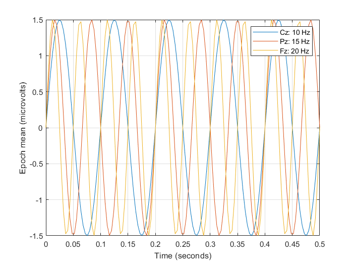

# Synthetic example: EEG export and spectral centroid

Download the [repository ZIP with the example and readiness fixes](https://github.com/MPG-Git/NeuroLode/archive/refs/heads/codex/readiness-20261107.zip),
extract it to a writable folder, and follow the setup below. These changes are
on the review branch; downloading the older default branch may omit them.
The input files and reference outputs are already included; generation is optional.

## Run and inspect

This is an EEGLAB plugin. Copy `Neurolode1.7` into EEGLAB's `plugins` folder,
then restart EEGLAB. Keep one installed version. The example is included inside
the plugin folder. MATLAB Audio Toolbox is required for the spectral example.
Reference environment: MATLAB R2023b and EEGLAB 2024.2.

```matlab
% After starting EEGLAB:
pluginRoot = fileparts(which('eegplugin_Neurolode'));
addpath(fullfile(pluginRoot,'examples','synthetic'));
run_neurolode_demo;
```

Or, with EEGLAB initialized and the extracted repository as the current folder:

```matlab
addpath('Neurolode1.7/examples/synthetic');
run_neurolode_demo;
```

`data/synthetic.set` contains Cz/Pz/Fz sinusoids at 10/15/20 Hz, 250 Hz sampling,
1,000 samples per epoch, and two epochs. Epoch amplitudes are 1 and 2 microvolts.
It has one `stim` event per epoch and can be loaded through EEGLAB's File menu.

The real export function produces `synthetic_Chans_1_2_3.csv`: channels are rows,
samples are columns, and the epoch mean has amplitude **1.5 microvolts**.
The runner checks all 3,000 values against the analytic sine waves (1e-6 tolerance).
Continuous conversion must preserve all 2,000 samples/channel in order.
The time-domain centroid export is an XLSX (or CSV fallback), also normalized to
`centroid.csv` for easy comparison. Channel mean centroids should be **10, 15,
and 20 Hz**, within 1e-4 Hz. `history.txt` records the replayable spectral call.

For GUI exploration, load the `.set`, then use the Neurolode export and spectral
centroid menu items. Choose channels `1:3`, average epochs for the export, and
leave channel averaging off. Compare with the bundled CSV and plot below.
Automated example checks cover the computational commands; the broader manual
menu checklist in the repository remains a pre-release check.



Recreate inputs with `generate_neurolode_data('new_data')` after initializing EEGLAB.

## What counts as success

A successful run prints `PASS` and writes `PASS.txt` and `comparison.csv` into
the new output folder. Errors and mismatches stop the runner without a PASS file.
Open the CSV comparison and compare your plots with `expected/`.
The included reference outputs came from actual runs on November 7, 2026.

The default output is this example's `output/` directory. Existing output folders
are refused so a previous result cannot be mistaken for a fresh run. MATLAB
runners accept a new output folder as their first argument (for example,
`run_neurolode_demo('demo_run_2')`).

If a comparison fails, inspect the reported metric and confirm that you used
these bundled files, this repository version, and the listed dependencies.
Do not replace the reference with the failing result. `SHA256SUMS.json` records
input/reference file hashes for download-integrity checks. All input data are
generated; no participant recordings or personal data are included. The supplied
generators refuse to overwrite an existing destination.

These examples check the illustrated installation and workflow, not every menu
item or scientific validity for a particular study. Reference plots may render
differently with another operating system or graphics version.
